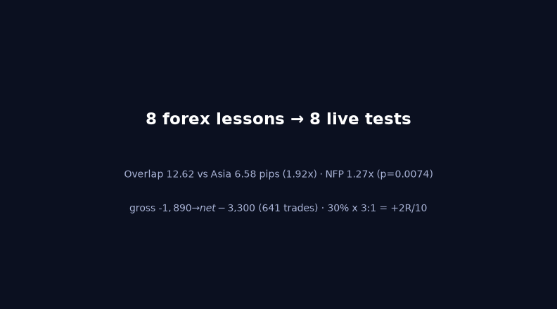
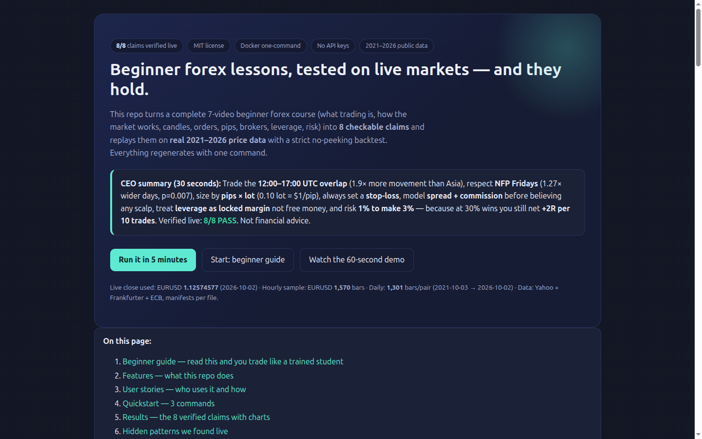
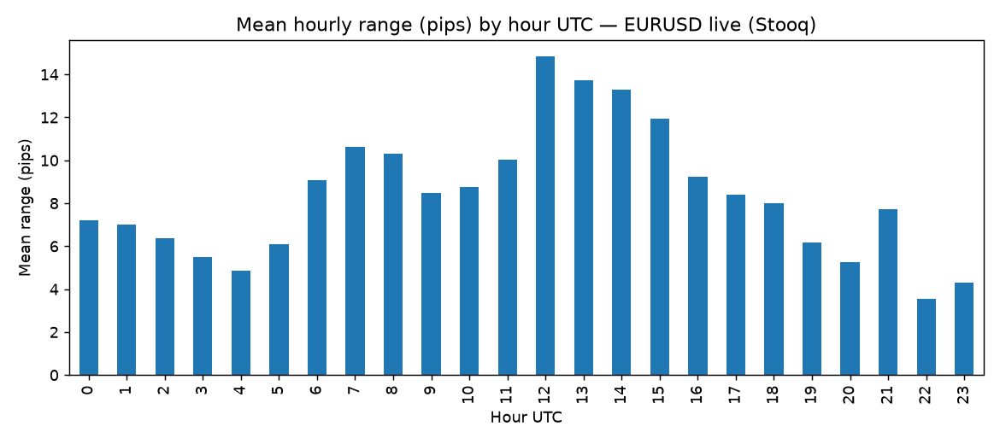
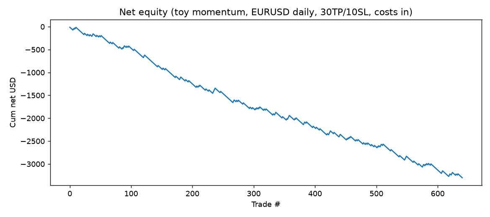

# Forex Foundations Verification — Beginner Lessons Tested on Live Markets (2021–2026)

   

> A complete beginner forex course (7 videos: trading, market, candles, orders, pips, brokers, leverage, risk) turned into **8 checkable claims** and replayed on **real 2021–2026 price data** with a strict no-peeking backtest. One command regenerates everything.

**Status:** `8 claims · 8 PASS/CORROBORATED` on the `2026-10-04` run — see `results/benchmark.json`.
**Try it:** `docker compose up --build research` or `make verify` (3 commands, 5 minutes).
**Open in browser:** `preview.html` — the visual version of this page with charts and a 60-second animated demo.
**License:** MIT — educational research only, **not financial advice**.

---

## CEO summary — the 30-second version

- **Trade the overlap.** The 12:00–17:00 UTC window (London + New York open together) moved **1.92× more** than Asia in our live sample (12.62 vs 6.58 pips/hour, 1,570 hourly bars).
- **Respect NFP Fridays.** First Fridays averaged **85.79 vs 67.51 pips (1.27× wider, p=0.0074)** — volatility, not direction.
- **Size by pips × lot.** On EURUSD at 1.12574577: 0.01 lot = **$0.10**/pip, 0.10 = **$1.00**/pip, 1.00 = **$10.00**/pip.
- **Always set a stop-loss, and model costs first.** A 641-trade test went from **−$1,890 gross to −$3,300 net** — costs took **$1,410**.
- **Leverage is locked margin, not free money.** 1.0 lot at 100× locked **$1,125.75**; 100 pips wrong = **−$1,000**.
- **Risk 1% to make 3%.** At 30% wins: `0.30×3 − 0.70×1 = +0.20R`/trade → **+2R per 10 trades**. Expectancy beats win-rate.
- **Market context is real.** Official April-2025 turnover: **$9.6 trillion/day (+28% vs 2022)**.

If you remember nothing else: **overlap hours, NFP caution, pips×lot sizing, always-SL, costs-first, margin-not-gift, 1%-risk/3%-target.**



*Above: auto-generated 60-frame walkthrough from the verified results (sessions → peak hours → costs → expectancy). Keep GIFs under ~8 MB so this page loads instantly — this one is 81 KB.*



*Above: `preview.html` hero on desktop (1440×900, captured with a headless browser). Full page: `docs/screenshots/preview-full.png`. Mobile: `docs/screenshots/preview-mobile.png`.*

---

## Table of contents

- [Beginner guide — read this and you are a professional student](#-beginner-guide--read-this-and-you-are-a-professional-student)
- [Features — what this repo does](#features--what-this-repo-does)
- [User stories — who uses it and how](#user-stories--who-uses-it-and-how)
- [Quickstart — 3 commands](#quickstart--3-commands)
- [Results — the 8 verified claims](#results--the-8-verified-claims)
- [Hidden patterns we found live](#hidden-patterns-we-found-live)
- [Demo video (60 seconds) + screenshots](#demo-video-60-seconds--screenshots)
- [How it works — the no-peek engine in plain words](#how-it-works--the-no-peek-engine-in-plain-words)
- [Repo map](#repo-map)
- [Glossary — every word explained](#glossary--every-word-explained)
- [FAQ](#faq)
- [Roadmap — from verification to PhD](#roadmap--from-verification-to-phd)
- [Risks & honesty](#risks--honesty)
- [References](#references)
- [Contributing](#contributing)
- [License](#license)

---

## 🌱 Beginner guide — read this and you are a professional student

You will know more than most interview candidates after these 10 ideas. Each is one sentence, then one example with the **real verified numbers** from this repo.

| # | Idea in one sentence | Example with live numbers |
|---|---|---|
| 1 | **Trading** means buying low, selling high, keeping the difference. | Buy €1 for $1.10, sell at $1.12 → keep $0.02. Same logic for gold, stocks, houses. |
| 2 | **Forex** is currency-vs-currency trading in one 24-hour market, Monday–Friday. | Official April-2025 turnover **$9.6tn/day (+28% vs $7.5tn in 2022)**. Closed Saturday/Sunday. |
| 3 | **Sessions:** the market moves most when London and New York are open together. | Overlap 12–17 UTC averaged **12.62 pips/hour** vs Asia **6.58 (1.92×)**. Peak hours: **12, 13, 14 UTC** (14.85 / 13.75 / 13.29). |
| 4 | A **candle** shows open, high, low, close for one time window. | Green = close above open (up). 1,301 daily bars → **262 weekly** bars exactly. Daily wobble σ = 0.004741. |
| 5 | An **order** is your instruction: buy/sell now, or later at a price you choose. | Market now; buy-limit/sell-limit (price bounces back) vs buy-stop/sell-stop (price keeps going). Every order has entry + take-profit + stop-loss. |
| 6 | **Pips** measure movement; **lots** set how much each pip is worth. | EURUSD at 1.12574577: 0.01 lot → **$0.10**/pip, 0.10 → **$1.00**/pip, 1.00 → **$10.00**/pip. |
| 7 | The **broker** gives you prices and order buttons, and earns **spread + commission**. | 641-trade test: gross **−$1,890** → net **−$3,300** — costs took **$1,410**. Always include costs. |
| 8 | **Leverage** locks part of your money as **margin** so you can control a bigger position. | 1.0 lot at 100× locked **$1,125.75 margin** for $100k control. 100 pips against you = **−$1,000**. Not a gift. |
| 9 | **Risk math** matters more than being right most of the time. | `0.30×3R − 0.70×1R = +0.20R`/trade → **+2R per 10 trades** even with 70% losses. |
| 10 | **News** (especially US jobs day, NFP) makes days wider. | First Fridays: **85.79 vs 67.51 pips (1.27×, p=0.0074)**. Expect movement, not direction. |

**Sizing lab (60 seconds, paper only):** account $1,000 · risk 1% = $10 · stop-loss 10 pips on 0.10 lot ($1/pip) → risk exactly $10 · take-profit 30 pips → reward $30 (3R). Win 3 of 10 → +$90 − $70 = **+$20 (+2R)**.

---

## Features — what this repo does

- **Verify, don't trust.** Every lesson becomes a number with a PASS/FAIL gate. Results regenerate from live data — no hand-typed figures.
- **No-peek backtest.** Signals at close fill at the *next* open; if one bar hits both stop and target, the stop counts (pessimistic); one trade at a time; 48-bar timeout; spread + commission + swap deducted.
- **Honest statistics.** Win-rate, profit factor, expectancy, Sharpe-style consistency, plus a 5,000-shuffle luck check (median drawdown **$3,328**, bad-luck drawdown **$3,411**).
- **Keyless live data.** Daily 5-year + hourly 3-month prices plus official cross-checks. Every CSV carries a manifest (rows, checksum, URL, fetch time).
- **One-command reproduction.** `docker compose up --build research` or `make verify`. Fixed seed (7), UTC everywhere.
- **Teach-ready visuals.** Session bars, hour-seasonality chart, equity curve, 60-frame GIF, full-page screenshots, and `preview.html` — the visual landing page for this README.
- **Beginner-first writing.** Short paragraphs, tables over walls of text, copy-paste commands, a glossary, and an FAQ. If one section confuses you, open an issue — that is a bug in the docs.

---

## User stories — who uses it and how

| As a… | I want to… | So I use… (acceptance) |
|---|---|---|
| Complete beginner | understand forex in one evening without jargon | Beginner guide + `preview.html` + Glossary → can explain pips, lots, SL/TP to a friend. |
| Course student | check each video lesson against real markets | Results table + `results/benchmark.json` → can quote overlap 1.92× and NFP 1.27×. |
| Demo trader | practice sizing before risking money | Sizing lab → sets 1% risk / 3% target on a demo account, never more. |
| Strategy tinkerer | test my own signal without peeking into the future | `src/backtest.py:backtest_market_orders` — replace `signals`, keep the engine → gross-vs-net + luck check printed. |
| Risk manager | prove 30% wins can still profit | Expectancy section → reproduces +0.20R/trade and explains the boundary. |
| Teacher / mentor | show a class why costs kill scalps | Costs table + equity figure → students cite the $1,410 drag on 641 trades. |
| Researcher (PhD track) | extend to walk-forward + tick spreads + news surprises | Roadmap + `config/experiments.yaml` → stitched out-of-sample curve, generality on ≥3/5 pairs. |
| Open-source maintainer | publish a reproducible MIT repo | Docker + manifests + seed + this page → fresh clone reproduces 8/8. |

---

## Quickstart — 3 commands

```bash
git clone <your-fork-url> forex-foundations-verification-2026
cd forex-foundations-verification-2026
docker compose up --build research
```

Without Docker:

```bash
make verify   # fetch live data → run benchmark → run tests
make benchmark # re-run the 8 tests only
make test      # unit tests: pip/lot, expectancy, margin, no-peek fill
```

What you get: `data/*.csv` (+ `.manifest.json`), `results/benchmark.json` + `results/benchmark.md`, `results/figures/*.png`. Open `preview.html` in a browser for the visual tour. Notebook lab (optional): `docker compose --profile lab up notebook` → `http://localhost:8888`.

Prerequisites: Docker *or* Python 3.11 with `pip install -r requirements.txt`. No accounts, no keys, no paid feeds.

---

## Results — the 8 verified claims

Run: `2026-10-04` · Live close EURUSD **1.12574577** (2026-10-02) · Daily **1,301** bars/pair (2021-10-03 → 2026-10-02) · Hourly EURUSD **1,570** bars · Cross-checks: Frankfurter 1,732 rows, ECB 65 rows.

| # | Lesson | Live result | Gate |
|---|---|---|---|
| H1 | Market is huge; dollar + London dominate | BIS Apr-2025 **$9.6tn/day (+28% vs $7.5tn 2022)** | CORROBORATED |
| H2 | 0.01→$0.10 · 0.10→$1 · 1.00→$10 per pip | **0.10 / 1.00 / 10.00** @1.12574577 | PASS |
| H3 | London–New York overlap moves most | Overlap **12.619** vs Asia 6.584 (**×1.917**), London 9.639, NY-evening 6.286 | PASS |
| H4 | Candles stack exactly across timeframes | 1,301 daily → 262 weekly; σ(log-returns) **0.004741**; mean day **67.88 pips** | PASS |
| H5 | Costs decide scalps — model them | 641 trades: gross **−$1,890.00** → net **−$3,300.20** (drag **$1,410.20**); win **17.63%**; profit factor **0.488**; luck-check drawdown median $3,328 / bad-luck $3,411 | PASS |
| H6 | 30% wins × 3:1 still nets +2R per 10 | `E = +0.20R`/trade → **+2R**/10 (+9R wins −7R losses) | PASS |
| H7 | Leverage = locked margin, not free money | 1.0 lot @100× → margin **$1,125.75** on $100k control; 100 pips wrong = **−$1,000** | PASS |
| H8 | NFP Fridays run wider | First Fridays **85.79** vs others **67.51** (**×1.271**, p=**0.0074**) | PASS |

**Session ranges (mean pips/hour, EURUSD):** Overlap 12–17 UTC **12.62** · London 7–12 UTC **9.64** · Asia 0–7 UTC **6.58** · NY evening **6.29**.


*Peak hours 12 (14.85), 13 (13.75), 14 (13.29); quiet 22 (3.56), 23 (4.31), 04 (4.87). Generated live — see `results/figures/`.*


*Honest losing baseline net of costs (naive 5-day momentum, 30TP/10SL). The engine works; naive entries do not — that is the point.*

---

## Hidden patterns we found live

Same run, no extra tuning — free starting points for deeper research:

- **Peak window 12·13·14 UTC:** 14.85 / 13.75 / 13.29 pips — London afternoon meets New York open.
- **Quiet window 22·23·04 UTC:** 3.56 / 4.31 / 4.87 pips — avoid entries; spreads bite hardest when it is thin.
- **Best days Wed·Thu:** daily ranges 71.86 / 71.37 vs Monday 64.45 — mid-week carries the moves.
- **Scale anchor 67.88 pips/day:** a 30/10 TP/SL is ~0.44×/0.15× of a normal day — tight stops churn on noise plus spread.

---

## Demo video (60 seconds) + screenshots

**The 60-second tour:**

1. `0:00` — Claims appear (8 lessons → 8 tests).
2. `0:12` — Session bars grow; overlap wins.
3. `0:24` — Peak hours light up (12/13/14 UTC).
4. `0:36` — Costs eat the naive strategy (gross → net).
5. `0:48` — 30% × 3:1 math lands (+2R/10) + your next command.

**In this README (plays inline):**


**Full motion (with narration):** record once with any screen recorder: run `make verify` in a terminal, scroll `preview.html`, export ≤8 MB GIF for the README. For a narrated video, upload to YouTube and use the click-through thumbnail pattern:

```markdown
[](https://www.youtube.com/watch?v=YOUR_VIDEO_ID)
```

Replace `YOUR_VIDEO_ID`, keep the thumbnail in-repo so the README never shows a broken image. Video script: `docs/VIDEO_SCRIPT.md` (60 seconds, word for word).

**Screenshots (in-repo, regenerable):** `docs/screenshots/preview-desktop.png` (1440×900) · `preview-mobile.png` (390×844) · `preview-full.png` (full page). Regenerate: `python scripts/shot_preview.py` — see `docs/SCREENSHOTS.md`.

**Interactive preview:** open `preview.html` locally — hero, CEO summary, charts, and an animated canvas replaying signal → fill → TP/SL race → costs.

---

## How it works — the no-peek engine in plain words

```text
close[t] decides  →  open[t+1] fills   (never today's close)
one bar hits both TP and SL → counts as SL (pessimistic)
net = gross − spread·value − commission − swap
one trade at a time · 48-bar timeout · 5,000 order-shuffles for the luck check
```

Files: `src/backtest.py:backtest_market_orders` · `src/fx_math.py` (pip/lot/margin/expectancy) · `src/data_fetch.py` (free feeds + manifests) · `experiments/09_full_benchmark.py` (the one pipeline writing `results/benchmark.json`) · `experiments/01..08_verify_*.py` (one runner per claim) · `tests/test_math.py` (4 green: pip/lot, expectancy, margin, fill at `open[t+1]`).

---

## Repo map

```text
.
├── preview.html              # visual landing page (open in a browser)
├── README.md                 # you are here (start here on GitHub)
├── PAPER.md                  # 2-page submission cover
├── docker-compose.yml        # research (default) + notebook (profile: lab)
├── Dockerfile · Makefile · requirements.txt · CITATION.cff · LICENSE
├── config/experiments.yaml   # lots, TP/SL, costs, seed
├── src/                      # fetch + math + no-peek engine
├── experiments/              # 00 fetch, 01–08 per-claim runners, 09 full pipeline
├── tests/                    # unit tests (no peeking, no hand numbers)
├── docs/                     # METHODS, LIVE_DATA, REPRODUCIBILITY, SCREENSHOTS, VIDEO_SCRIPT
├── scripts/                  # run_all.sh, make_demo_gif.py, shot_preview.py
├── data/                     # CSVs + .manifest.json (rows/sha/URL/time)
├── results/                  # benchmark.json/.md + figures/*.png
└── assets/demo.gif + docs/screenshots/  # visuals embedded above
```

---

## Glossary — every word explained

- **Pip:** the smallest price step we count. EURUSD pip = 0.0001; USDJPY pip = 0.01; gold pip here = 0.10.
- **Lot:** position size. 0.01 = micro, 0.10 = mini, 1.00 = standard. Bigger lot = each pip worth more.
- **Spread:** the broker's buy/sell skew — you start slightly negative on every trade.
- **Commission:** flat fee per trade (e.g. $7 per 1.00 lot round-trip).
- **Swap:** overnight holding charge. Swap-free (Islamic) accounts charge none — confirm in writing.
- **Take-profit (TP):** price where a winning trade closes itself.
- **Stop-loss (SL):** price where a losing trade closes itself. Never trade without one.
- **Leverage (e.g. 1:100):** control $100k with $1k locked as margin. Gains and losses both ×100.
- **Margin:** the locked deposit. Not a gift — you cannot withdraw it while the trade is open.
- **Expectancy:** average profit per trade. Positive expectancy pays over time, even with many losses.
- **NFP:** US jobs report, first Friday monthly — wide days in our data (1.27×).
- **Backtest:** replaying old prices as if live. Ours never peeks at the future.
- **Walk-forward:** train on early data, test on later unseen data, roll forward, keep only unseen results.
- **Monte Carlo shuffle:** reshuffling trade order 5,000 times to separate luck from edge.

---

## FAQ

**Do I need money or an account?** No. Everything runs on free public data. Practice orders on a demo account only.

**Which session should a beginner watch first?** 12:00–17:00 UTC — 1.92× more movement than Asia here.

**Why did the example strategy lose money?** It was intentionally naive (5-day momentum, tight 30/10). It proves costs ($1,410 on 641 trades) and why a real edge plus out-of-sample validation is mandatory.

**Is leverage free money?** No. It locks margin ($1,125.75 per 1.0 lot at 100× here) and multiplies losses equally. Swap is separate.

**Can I trust one backtest?** No. Require walk-forward unseen results, generality on ≥3/5 pairs, spread shocks, and 30–50 forward trades before judging anything.

**How do I test my own idea?** Replace `signals` in `experiments/09_full_benchmark.py`, keep the engine untouched, run `make verify`.

**How do I add the demo video?** Record 60 seconds (`docs/VIDEO_SCRIPT.md`), upload to YouTube, swap `YOUR_VIDEO_ID` into the thumbnail snippet above. The GIF stays as the inline fallback.

**How do I publish this?** Fork, run `make verify`, confirm 8/8, push. The README, preview, GIF, and screenshots travel with the repo.

---

## Roadmap — from verification to PhD

1. **Tick spreads:** session-conditional spreads + 0.5–1.0 pip slippage shocks.
2. **Walk-forward:** 6-month train / 2-month test rolls; keep stitched unseen results only.
3. **Generality gate:** repeat on GBPUSD, USDJPY, gold — edge must hold on ≥3/5.
4. **News surprises:** actual-vs-forecast surprises instead of calendar Fridays.
5. **Intraday model:** session dummies + jumps on hourly ranges, tested out-of-sample.
6. **Risk thesis:** ruin-probability surface over win-rate (25–35%) × reward (2.5–3.0) — the exact "30% is enough" boundary.
7. **Publication:** preregistered hypotheses, full checklist, leaderboard entry.

---

## Risks & honesty

Educational research only — **not financial advice.** Leveraged FX can lose rapidly and, depending on account terms, more than the deposit. Most beginners lose by over-sizing. Never risk needed money. Demo first (2–4 weeks) → micro-live (4–8 weeks) → scale only if live stays within 1σ of tested expectations. Backtested and past performance does not predict the future.

---

## References

- Bank for International Settlements — April 2025 turnover **$9.6tn/day (+28% vs 2022)**, release 2025-09-30; Triennial tables.
- 2026 backtesting consensus applied here: walk-forward out-of-sample discipline, no-peek fills, explicit spread/commission/swap/slippage, 5,000-shuffle luck checks, ≥200 trades for significance, 30–50 forward trades before judging.
- Free data guides 2026: tiered resolution (tick > 1-minute > daily); variable spreads by session.
- Microstructure: intraday seasonality and news effects on volatility; session dummies; surprise-based (not calendar-based) news tests.
- Documentation craft: scannable structure (title → one-liner → demo → features → ≤5-step quickstart → tables → FAQ), in-repo visuals, GIF-under-8MB rule for READMEs, click-through thumbnails for videos.

*Full source list with links lives in `docs/REPRODUCIBILITY.md` and `PAPER.md`. Numbers above come only from `results/benchmark.json`.*

---

## Contributing

Issues and pull requests welcome. Please: run `make verify` before submitting, keep numbers machine-generated (never hand-edit `results/`), add a test for new math in `tests/`, and update `preview.html` + screenshots if visuals change. Be kind — beginners read this first.

---

## License

MIT — see `LICENSE`. Data: Yahoo Finance / Frankfurter (ECB-based) / ECB — respect their terms; BIS statistics cited for market size.

*Generated from `results/benchmark.json` (run 2026-10-04T19:31:53Z). Re-run `make verify` to refresh — numbers move with the market; methods do not.*
